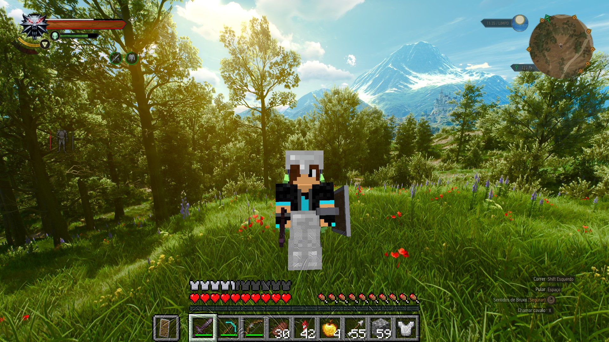
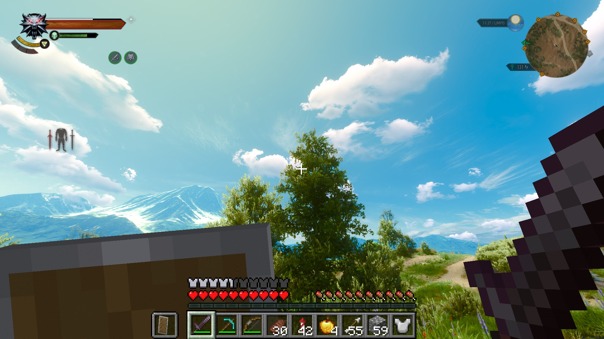
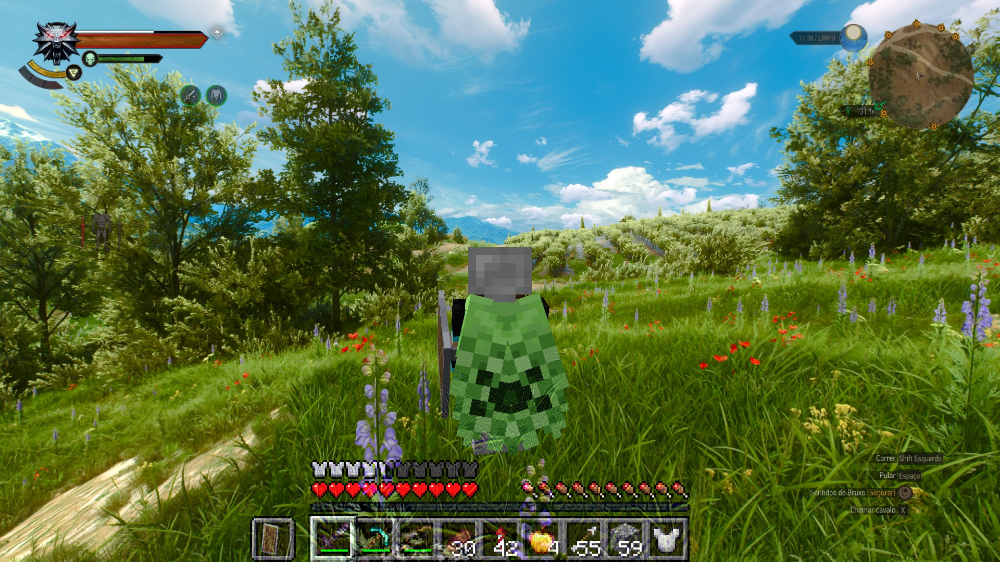

# MineWitcher3



Play The Witcher 3 as a Minecraft player. You move with Minecraft's physics, carry Minecraft's
inventory, HUD and skin, and fight The Witcher 3's monsters and NPCs with Minecraft weapons. They
fight back.

Neither game is rewritten. Minecraft runs its own game logic, and The Witcher 3 runs its world,
NPCs, quests and saves. A native plugin loaded into `witcher3.exe`, a WitcherScript mod and a
Minecraft Fabric mod talk to each other through shared memory. Minecraft runs hidden in the
background, and The Witcher 3 draws the frame.

MineWitcher3 is a port of [SkyCraft](https://github.com/chasmlol/skycraft) (Skyrim + Minecraft) to
The Witcher 3 Remastered. The Minecraft half and the shared-memory protocol come from SkyCraft; the
Witcher 3 half was built from scratch by reverse engineering `witcher3.exe` (REDengine 3, DX12).

> **Status: early and experimental.** Expect rough edges, and back up your saves.
> This is a fan project. It isn't affiliated with Mojang, Microsoft, CD PROJEKT RED or chasmlol,
> and you need to own both games.

| | |
|---|---|
|  |  |
| First person, with Minecraft's hand, HUD and crosshair | **F5** third person with your own skin and cape |

## What works

- **Movement:** Minecraft movement on The Witcher 3's terrain and buildings: walking, sprinting,
  jumping, crouching, swimming and falling. The Witcher 3's collision is scanned around you and
  fed into Minecraft's own collision. Geralt stays in the world as an invisible puppet that follows
  you, so NPCs still see you, greet you and attack you.
- **Camera:** Minecraft's F5 camera modes (first person, behind, in front) drive The Witcher 3's
  camera, with Minecraft's mouse sensitivity and FOV. Ticks are interpolated on the game's clock
  for smooth motion.
- **HUD and screens:** Minecraft's hand, hotbar, hearts, hunger, armor, crosshair, chat and
  inventory are drawn over The Witcher 3, next to its own HUD and minimap.
- **Your skin:** in F5 your Minecraft skin, armor, cape and held items are shown (see limitations).
- **Combat:** hit The Witcher 3's monsters and hostile NPCs with any Minecraft weapon. They
  flinch, stagger on crits and sprint hits, die, and give XP, loot and quest progress through the
  game's own damage system. Damage is scaled to the target's level and to bosses. Damage you
  take in The Witcher 3 (after its armor, Quen and dodges) goes to your Minecraft hearts, and
  dying in Minecraft kills Geralt.
- **Survival and Creative:** it's Minecraft's game mode. `/gamemode creative` or **F3 + F4**.
- **Game menus still work:** inventory, map, journal and the pause menu are The Witcher 3's.

## Requirements

**The Witcher 3**

| | |
|---|---|
| The Witcher 3: Wild Hunt **Remastered**, DX12 | Developed and tested on **5.0.15.65482** (Steam). Other builds may need the byte patterns updated. |
| Windows 10/11 x64 | |
| **Smart App Control off** (Windows 11) | Windows blocks unsigned DLLs such as `mw3.asi` while it's on. On many Windows 11 builds it can't be turned back on without a reset. |
| DLSS/FSR **Frame Generation off** | Recommended; the overlay isn't tagged for frame generation. |

The native plugin is loaded by [Ultimate ASI Loader](https://github.com/ThirteenAG/Ultimate-ASI-Loader)
(as `winmm.dll`) and registers its WitcherScript functions through
[WitcherNativeBridge](https://github.com/rejuvenate7/WitcherNativeBridge). Both are included.

**Minecraft**

You only need **a Microsoft account that owns Minecraft: Java Edition**. The setup script installs
a portable [Prism Launcher](https://prismlauncher.org/) with Minecraft 26.3,
[Fabric](https://fabricmc.net/) Loader 0.19.5, [Fabric API](https://modrinth.com/mod/fabric-api)
and the MineWitcher3 Minecraft mod, in its own instance. Your normal `.minecraft` isn't touched.

Minecraft runs hidden next to The Witcher 3. Budget about 4 GB of extra RAM and a GPU that runs
both games.

## Installing

There's no packaged release yet: build from source (below), then:

1. **Set up Minecraft:** `powershell -ExecutionPolicy Bypass -File tools\setup_minecraft.ps1`
   installs Prism and the `MineWitcher3` instance in `%LOCALAPPDATA%\MineWitcher3`.
2. **Sign in once:** open `%LOCALAPPDATA%\MineWitcher3\Prism\prismlauncher.exe` and add your
   Microsoft account. Launching the instance once lets Prism download Minecraft and Java.
3. **Install into The Witcher 3:** run `.\install.ps1` from an admin PowerShell. It copies the
   WitcherScript mod to `mods\modMineWitcher3`, the ASI Loader, `WitcherNativeBridge.asi`,
   `mw3.asi` and `mw3.ini` to `bin\x64_dx12`, and adds the mod's keys to `input.settings` (with a
   backup). The game folder (Steam libraries or GOG) and your Documents folder are detected
   automatically; pass `-GameDir <folder>` / `-Settings <input.settings>` to override.
4. **Play:** start The Witcher 3 normally and load a save. Minecraft starts by itself with no
   window, opens its own world (a new Survival world on your PC), connects, and quits when the
   game closes. The first start takes a minute.

Uninstalling: `.\install.ps1 -Uninstall` removes everything from the game folder and restores
`input.settings`. Delete `%LOCALAPPDATA%\MineWitcher3` to remove Minecraft, your Prism sign-in
and the world.

### Settings

`bin\x64_dx12\mw3.ini`:

```ini
[Minecraft]
bStartMinecraft=1        ; 0: don't start Minecraft (plain Witcher 3, the camera mod stays)
sLauncher=               ; empty: the portable Prism from setup_minecraft.ps1
sArguments=--launch MineWitcher3

[Input]
bForwardInput=1          ; 0: never send keyboard/mouse to Minecraft

[Collision]
iTracesPerFrame=200      ; collision raycasts per frame
bCapture=0               ; 1: record traced columns to mw3_colcapture.bin for offline replay

[Motion]
bInterpolate=1           ; 0: no tick interpolation

[Overlay]
bEnable=1                ; Minecraft hand/HUD/screens over the game
```

## Controls

Minecraft has priority. These keys still go to The Witcher 3:

| Key | Does |
|---|---|
| **Esc** | Witcher 3 menu (or closes an open Minecraft screen) |
| **I** / **M** / **J** / **K** | Witcher 3 inventory / map / journal / character |
| **~** | Witcher 3 console |
| **F6**–**F9** | Witcher 3 (F9 quickload) |
| **O** | Minecraft pause / options menu |

Every other key is Minecraft's: **E** inventory, **F5** camera, **T** chat, **/** commands,
**Shift** crouch, and so on. **F5 never quicksaves** while the mod is installed (the engine
hardcodes quicksave on F5); save from the Esc menu.

Console tuning (Witcher 3 console, `~`): `mw3hitscale(1.5)` (damage you deal),
`mw3hurtscale(0.5)` (damage you take), `mw3combatlog(false)` (combat lines in `mw3.log`),
`mw3anim(0)` (Geralt's walk animation under the puppet off).

## Known limitations

- If something goes wrong, `bin\x64_dx12\mw3.log` says what. Minecraft's log is
  `%LOCALAPPDATA%\MineWitcher3\Prism\instances\MineWitcher3\.minecraft\logs\latest.log`. Script
  compile errors are shown by the game at startup; only the `Error` lines matter.
- **Placed Minecraft blocks are invisible.** Minecraft knows where they are, but nothing draws
  Minecraft's world inside The Witcher 3's frame yet. This is the biggest missing piece.
- **Your F5 avatar is drawn by Minecraft on top of the frame**, so Witcher 3 walls, grass and NPCs
  don't hide it, it uses Minecraft's lighting and casts no shadow.
- Collision comes from raycasts on a 0.5 m grid around you: thin fences and poles can be missed,
  and running into areas that haven't been scanned yet can feel like an invisible wall for a
  moment.
- Uneven Witcher 3 terrain becomes small steps for Minecraft; the camera smooths them, but very
  bumpy ground still isn't perfectly smooth.
- Civilians and horses can't be hit (only enemies the game lets you attack).
- Digging into The Witcher 3's terrain, Minecraft lights, synced saves and multiplayer from
  SkyCraft are not ported yet.
- Shift/Ctrl/Alt can still reach The Witcher 3 (it reads modifiers directly).
- Mods that replace the camera or `winmm.dll` will conflict.

## Building from source

You need Visual Studio 2022 Build Tools (C++ and CMake), JDK 25, and Python 3 (optional, for the
tools).

```bat
:: native plugin (mw3.asi + WitcherNativeBridge.asi) into native\build\Release
powershell -File build.ps1

:: Minecraft mod into fabric\build\libs
cd fabric
gradle25.cmd build
```

Offline tests (no game needed): `native\build\Release\mw3_linktest.exe`, `mw3_coltest.exe`,
`mw3_motiontest.exe`, `mw3_combattest.exe`, `mw3_overlaytest.exe`.
`python tools\fake_witcher.py` stands in for the game so the Minecraft side can be tested alone.

| Folder | |
|---|---|
| `native/` | The native plugin loaded into `witcher3.exe` (C++): link, launcher, input, D3D12 overlay, collision, combat, tick interpolation |
| `mod/` | The WitcherScript mod: camera, Geralt puppet, collision raycasts, combat |
| `fabric/` | The Minecraft Fabric mod (Java), derived from SkyCraft |
| `protocol/` | The shared-memory protocol between them |
| `tools/` | Minecraft setup, `fake_witcher.py`, reverse-engineering and crash scripts |
| `third_party/` | WitcherNativeBridge (source) and Ultimate ASI Loader |
| `research/` | Reverse-engineering notes on `witcher3.exe` and design/diagnosis write-ups |

## Credits and license

- [SkyCraft](https://github.com/chasmlol/skycraft) by chasmlol (MIT): the Minecraft mod, the
  protocol and the overall design.
- [WitcherNativeBridge](https://github.com/rejuvenate7/WitcherNativeBridge) (MIT) and
  [Ultimate ASI Loader](https://github.com/ThirteenAG/Ultimate-ASI-Loader) by ThirteenAG (MIT).
- Prism Launcher (GPL-3.0) and Fabric API (Apache-2.0) are downloaded, not bundled.

MineWitcher3 is released under the [MIT License](LICENSE). Full third-party license texts are in
[THIRD-PARTY-NOTICES.md](THIRD-PARTY-NOTICES.md).
